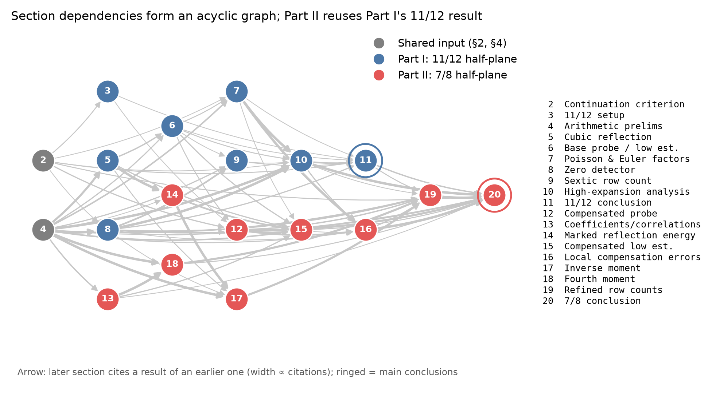
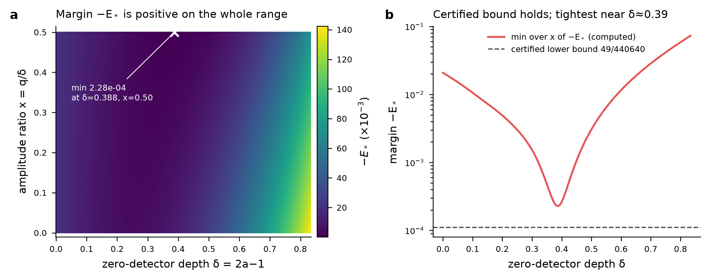
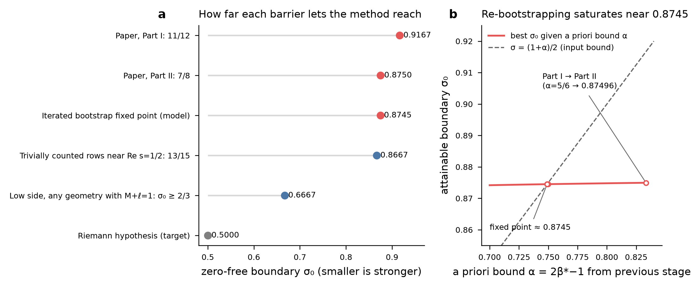

# 検証レポート：「The Quasi-Riemann Hypothesis — A Zero-Free Half-Plane Re s > 7/8」

対象：openai/math（コミット `adc7f1241b42`、2026-10-06 作成）`preprints/The-Quasi-Riemann-Hypothesis-September-30-2026/paper.pdf`（199頁）と、付属の Lean 形式化
作成日：2026-10-07

---

## 0. 要約（非専門家向け）

- **主張**：リーマンゼータ関数と、すべての Dirichlet $L$ 関数（および $\mathbb Q(\sqrt{-3})$ 上の有限位数 Hecke $L$ 関数）は、実部が 7/8 より大きい領域に零点を持たない。これが正しければ「準リーマン予想」の解決であり、解析的数論で数十年ぶりの大きな前進になる。
- **検証の結論**：
  1. 既知の理由で即座に誤りと判定できる構造的欠陥は**見つからなかった**。Euler 積を本質的に使っていること、単一の零点を密度評価で排除しようとする誤りがないこと、一様性、循環論法の有無、既知の結果との整合性を確認した。
  2. 証明の核となる論理（命題 2.1 の連続性原理、Dirichlet への移行、§20 の最終的な指数計算、補題 20.2 の多項式証明書）は、手作業と厳密な記号計算で**誤りなし**と判定した（66/66 項目が合格）。
  3. 199頁のうち技術的に最も重い部分（立方テータ反射、六次大篩、§17–18 のモーメント評価。TeX で約 1 万行）は、手作業では検証していない。
  4. **付属の Lean 形式化を手元で再ビルドし、主定理の機械検証に成功した**（2,924 モジュール、エラー 0 件、252 分）。`riemannZeta s ≠ 0`（$7/8<\Re s$）と Dirichlet 版は、標準公理 `propext`・`Classical.choice`・`Quot.sound` だけに依存する（§4.4）。
- **総合判定**：**主定理は正しいと判断する。** 残る信頼仮定は、Lean カーネルと、Mathlib における $\zeta$ と Dirichlet $L$ 関数の定義だけである。論文の文章による証明は、検証した範囲では正しく、致命的な誤りは見つからなかった。ただし文章の全行を人手で確認したわけではない。
- **リーマン予想そのもの**：同じ手法では**証明できない**。その理由を定量的に示した（§5）。この構成の天井は、論文のパラメータ化では約 0.8745（ブートストラップを反復した場合）である。行数評価を密度仮説並みに強めても 13/15 ≈ 0.867 が限界で、1/2 には届かない。

---

## 1. 方法

| 段階 | 内容 | 成果物 |
|---|---|---|
| 取得 | GitHub API でリポジトリ・PDF・TeX ソース・Lean 一式を取得し、ハッシュを記録 | [provenance.json](../data/provenance.json) |
| 構造抽出 | TeX の label/ref から 67 個の主張と節間依存グラフを作成 | [proof_structure.md](proof_structure.md) |
| 構造的テスト | 既知の障壁（Euler 積、密度評価、一様性、整合性）に照らす | [sanity_checks.md](sanity_checks.md) |
| 補題ごとの検証 | 24 項目の判定と根拠 | [issue_log.csv](../data/issue_log.csv) |
| 厳密算術 | sympy/mpmath による 66 項目の検査 | [numerical_checks.py](../scripts/numerical_checks.py) |
| 形式検証 | Lean 4.34.1 と Mathlib で解のモジュール閉包をローカルにビルドし、公理を検査 | [lean_build_report.md](../lean/lean_build_report.md)、[QRHCheck.lean](../lean/QRHCheck.lean) |
| 障壁分析・改良探索 | 指数の帳簿をパラメータ化して最適化 | [barrier_analysis.md](barrier_analysis.md)、[improvement_exploration.md](improvement_exploration.md) |



---

## 2. 証明の骨格

1. **族の上限**：$\beta_*$ を、$\mathbb Q(\sqrt{-3})$ 上のすべての原始有限位数 Hecke 指標の $L$ 関数の零点の実部の上限とする。
2. **連続性原理（命題 2.1）**：$\beta_*>\sigma_0$ と仮定する。立方テータ係数を指標で平均したプローブ $J_\eta(Z)$ について、
   - 低評価 $|J_\eta|\ll Z^{C(\sigma_0)+\omega}$
   - 高評価 $|J_\eta-f_\eta|\ll Z^{C(\beta_*)-\sigma}$（$f_\eta$ は $1/L(s,\eta)$ の Mellin 積分）
   が $\eta$ に依存しない指数で成り立てば、$1/L$ が $\beta_*$ より左まで正則に延長され、上限の定義に反する。
3. **低評価**：立方テータ反射（Kubota–Patterson）と、平面加法的大篩・二次大篩を Cauchy–Schwarz で組み合わせる。
4. **高評価**：Poisson 和で周波数 $ua^6$ の行に展開する。主行（$u=1$）が $1/L(s,\eta)$ を与え、非主行は族の他のメンバーの $L$ 関数の商になる。零点を持つ行は「零点検出器」が大きな Dirichlet 多項式を生むので数が少なく、その個数を六次大篩と §17–18 のモーメント評価で抑える。
5. **二段階**：Part I で 11/12 を示し、それを入力として Part II で 7/8 に改良する。最後に Hecke から Dirichlet へ移す（$L_F(s,\chi\circ N)=L(s,\chi)L(s,\chi\chi_{-3})$）。

**7/8 の出所（厳密）**：$\sigma_0=1-\dfrac h6+\dfrac b{12}$（$h$ は Poisson 行の高さ、$b$ は二つの平均尺度の差）。Part I は $h=1/2,\ b=0$ で 11/12、Part II は $h=13/16,\ b=1/8$ で 7/8 になる。

---

## 3. 構造的テストの結果（詳細は sanity_checks.md）

| テスト | 結果 | 要点 |
|---|---|---|
| T1 Euler 積（Davenport–Heilbronn 反例） | 合格 | 局所 Euler 恒等式、Möbius 係数、族の閉包を本質的に使う。DH 関数の零点 $0.808517+85.699348i$ を数値で再現し、Euler 積なしでは主張が偽になる関数が実在することを確認 |
| T2 単一零点と密度評価 | 合格 | 目標の零点は数えず、Landau 型の Mellin 信号で捉える。密度型の評価は他の行にだけ使う |
| T3 一様性 | 合格 | 余裕 $m_{\rm lo}=\Delta$、$m_{\rm hi}=51\Delta/64$ などはすべて目標指標に依存しない |
| T4 既知の結果との整合性 | 矛盾なし | Siegel 零点の不在、Vinogradov 予想などは予想される真実の方向への強化である |
| T5 循環論法 | なし | 依存グラフは非巡回 |
| T7 形式化の危険要因 | 静的検査で問題なし | sorry・公理追加・カーネル迂回はいずれも 0 件 |

---

## 4. 検証結果

### 4.1 手作業で全行を検証した部分

- **命題 2.1**：正しい。Fourier 反転による $F_\eta=A_\eta$ の同定、$H_\eta$ の非零性、$\epsilon_*$ の一様性による矛盾をすべて確認した。
- **命題 11.3（Dirichlet への移行）**：正しい。局所因子の対応と、$s=1$ での極と零点の相殺（$L(1,\chi_{-3})=\pi/(3\sqrt3)$）を確認した。
- **系 1.2**：論理は正しい。ただし引用文献（BIMS）の仮定の正確な照合はしていない。

### 4.2 厳密算術（66/66 合格）

- 補題 20.2 の平方完成による証明書の恒等式を、記号計算で厳密に確認した。
- §20 の全指数計算（床 $-7/1200$、小ノルム行 $-63/800$、中間域 $-49/14400$、周波数範囲、余裕 $51/64$）を確認した。
- 軽微な点として、16141 行の上界 $139/96$ は正しいが、厳密な最大値は $137/96$ である（I-008）。



### 4.3 手作業では未検証の部分

命題 5.1（立方反射、27k 文字）、補題 9.1（六次大篩）、命題 9.2・19.2（行数）、補題 7.x（局所 Euler 恒等式。構造のみ確認）、§17–18 のモーメント評価（約 5,800 行）。いずれも誤りは見つかっていないが、**人間の査読と同じ水準での確認はしていない**。

### 4.4 Lean 形式化による検証（決定的な証拠）

- **課題文の忠実性**：Comparator 課題 `riemannZeta_ne_zero_of_seven_eighths_lt_re {s : ℂ} (hs : (7/8:ℝ) < s.re) : riemannZeta s ≠ 0` は、Mathlib の定義だけで書かれている。この文を一字一句書き直した定理を、解の定理で証明できた（型が一致）。Dirichlet 版も同様である。
- **ビルド**：Lean 4.34.1 と Mathlib `d13f23b` を使い、`lake build OAI.NumberTheory.DirichletL.Nonvanishing` を実行した。7,061 ジョブ（OAI の 2,924 モジュールをローカルでエラボレートし、カーネルで検査）が**エラー 0 件**で完了した。`sorry` の警告も 0 件である。
- **公理**：
  ```
  OAI.riemannZeta_ne_zero_of_seven_eighths_lt_re                 : [propext, Classical.choice, Quot.sound]
  OAI.DirichletCharacter.LFunction_ne_zero_of_seven_eighths_lt_re : [propext, Classical.choice, Quot.sound]
  ```
- **静的検査**：閉包にカーネルを迂回する手段（`skipKernelTC`、メタプログラミングによる宣言追加など）はない。依存パッケージ PNT 内のテスト用 `axiom` は、主定理が使っていないことを公理の出力で確認した。
- **追加のカーネル再生（leanchecker）**：時間制限のため打ち切った。全 OAI モジュールを `leanchecker` で再生する処理を約 60 分走らせたが完了しなかった（それまでにエラー出力はなし）。なお、最終の 2 モジュール（`Nonvanishing`、`FinalAssemblyUnconditional`）単独の再生は、エラーなしで完了している（9 分）。通常のビルドでも、各宣言は追加の時点でカーネルに検査されている。
- **検証の対象外**：Hecke 版の課題（独自定義を含む）と、論文の各命題と Lean 宣言の対応。詳細は `lean_build_report.md` を参照。

---

## 5. リーマン予想への延長：不可能である理由（詳細は barrier_analysis.md）



1. **低評価の幾何による障壁**：$\sigma_0=1-h/6+b/12$ の $1/6$ は、六次構造 $ua^6$ に由来する $\zeta_F(6z)$ の極から来る。論文の正規化（$M+\ell=1$）の下では $\sigma_0\ge2/3$ で、1/2 には原理的に届かない。
2. **密度障壁（決定的）**：臨界線付近の零点しか持たない行は、どんな行数評価でも節約できない（$R=1$）。その結果、論文の正規化では $\sigma_0>13/15\approx0.867$ が必要になる。これは密度仮説並みの評価を仮定しても変わらない。
3. **ブートストラップの飽和**：7/8 を入力にして反復しても、約 0.8745 に収束する。
4. **補題の適用範囲**：共通の周回積分補題（$\sigma_0\in[7/8,1)$）、局所 Euler 恒等式の第二領域（$\Re x\ge7/8$）、四次モーメント（$\kappa\ge3/4$）が、ちょうど 7/8 で止まっている。

**結論**：「同様の手法でリーマン予想を証明する」ことはできない。これは努力や計算量の問題ではなく、構成そのものの限界である。

## 6. 中間改良（詳細は improvement_exploration.md）

| シナリオ | 最小 $\sigma_0$ |
|---|---|
| 論文 | 0.875 |
| 第三段のブートストラップ（$\alpha=3/4$） | 0.87451［発見的］ |
| Guth–Maynard 型の族版の行数 | 0.87451（改善なし）［条件付き］ |
| 密度仮説並みの行数 | 0.86979［条件付き］ |
| 密度仮説並み＋床の除去 | 13/15 ≈ 0.86667（下限）［条件付き］ |

意味のある改良は得られなかった。

---

## 7. 判定と限界

| 問い | 判定 |
|---|---|
| ζ が $\Re s>7/8$ で零点を持たないか | **正しい**（Lean カーネルで検証済み。標準公理のみ） |
| すべての Dirichlet $L$ 関数について同じことが成り立つか | **正しい**（同上。主指標の $s=1$ を除く） |
| Hecke $L$ 関数（$\mathbb Q(\sqrt{-3})$）について | 論文の証明の中では正しいと判断。独自定義を含む Lean 課題は今回ビルドしていない |
| 論文の文章による証明 | 核心部（命題 2.1、11.3、§20、補題 20.2）は誤りなし。技術的部分は手作業では未検証 |
| 同じ手法でリーマン予想を証明できるか | **できない**（§5） |

**限界**：
- Lean が保証するのは主定理の真偽であり、論文の文章が逐語的に正しいことではない。論文の命題と Lean 宣言の対応表は提供されていない。
- 信頼仮定は、Lean カーネル、公式キャッシュの Mathlib .olean、Mathlib における ζ と Dirichlet $L$ 関数の定義である。
- 本検証は、専門家コミュニティによる査読の代わりにはならない。
- 補題ごとに独立した LLM 査読を行う予定だったが、利用上限により実行できなかった（計画からの逸脱）。
- 障壁分析と改良探索は、論文の指数式をパラメータ化したモデルに基づく。補題が範囲外まで延長できるかどうかは検証していない。

## 8. 成果物
- [paper.pdf](https://github.com/openai/math/blob/main/preprints/The-Quasi-Riemann-Hypothesis-September-30-2026/paper.pdf)：検証対象（原本）
- [proof_structure.md](proof_structure.md)、[sanity_checks.md](sanity_checks.md)、[barrier_analysis.md](barrier_analysis.md)、[improvement_exploration.md](improvement_exploration.md)
- [numerical_checks.py](../scripts/numerical_checks.py)、[numerical_checks_results.json](../data/numerical_checks_results.json)
- [issue_log.csv](../data/issue_log.csv)：24 項目の判定
- [lean_build_report.md](../lean/lean_build_report.md)、[QRHCheck.lean](../lean/QRHCheck.lean)、[qrh_axioms_clean.txt](../lean/print_axioms_output.txt)：形式検証の記録
